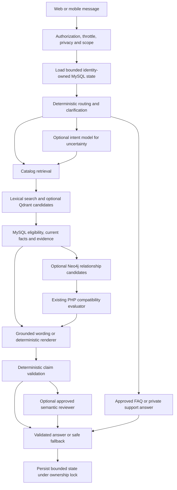

# Battlefront AI integration implementation plan

Status: local implementation authorized by the developer on 2026-11-01, including the reported adviser-approved chatbot recommendation and exact-part compatibility scope. The initial audit and proposal are historical snapshots; later dated sections describe the approved implementation and development activation. The initial preparation did not provision cloud resources or apply application migrations. Approved development activation and local migrations performed on 2026-11-02 are recorded below; this does not claim production deployment.

## 1. Executive summary

Keep MySQL authoritative and preserve deterministic support answers and ownership checks. Qdrant and Neo4j are rebuildable projections, not business authorities. The original proposal below preceded approval for model-led understanding, grounded recommendations, exact-part compatibility, and three-stage review; dated approval and implementation notes supersede its open questions.

The repository contains Gemini intent and response agents, Algolia catalog search, multilingual normalization, encrypted conversation references, and a deterministic PC Builder compatibility engine. The legacy orchestration remains available. Provider integration, model-led understanding, and adaptive orchestration are disabled by default; when the approved paths are enabled, eligible public inquiries can use bounded scope, grounded generation, and review within the shared three-call ceiling. Deterministic FAQ and private-order support remain zero-call in the new path.

The original pre-approval proposal treated durable memory, recommendations/exact-part compatibility, and additional Gemini calls as open decisions. The developer later authorized local implementation, and reported an adviser-approved scope amendment for catalog-grounded recommendations and compatibility. Preserve those approvals and the separate production/cloud release gates; do not re-open already settled scope in this plan.

## 2. Baseline architecture captured during the 2026-11-01 audit

The findings in this section describe the pre-implementation audit snapshot. The dated implementation and activation updates below supersede baseline statements where the code, schema, or external development services have since changed.

### Evidence and audit limits

**Verified** means inspected repository source, installed dependencies, route output, or live schema through Laravel Boost. **Provider fact** means official documentation consulted during this audit; entitlements still require account verification. **Proposed** means design guidance, not working integration. No customer rows, provider secrets or actual customer messages were collected. No runtime integration success or test-pass claim is made.

Read `AGENTS.md`, `.ai/rules/index.md`, general/chatbot/catalog/PC Builder architecture rules, `docs/CAPSTONE_CONTEXT.md`, and relevant paragraphs from the actual manuscript `docs/capstone_manuscript.docx` (underscore; the requested hyphenated name is absent). The manuscript retains older Gemini/Flutter references; current code and approved implementation references use Gemini 3.5 Flash-Lite and a separate React Native/Expo consumer. Preserve the manuscript; formal manuscript synchronization remains developer-owned. The initial audit did not include a current Linear issue; the later local implementation proceeded under the explicit developer authorization recorded above.

Graphify CLI initially failed under the sandbox because its Python executable was inaccessible. The architect used graph JSON source-location discovery; provider specialists successfully ran graphify after escalation. Graph relationships were navigation aids, not evidence that integrations run. No source code changed, so no code-driven graph rebuild was necessary.

### Runtime and deployment boundaries

| Area | Verified finding | Evidence |
| --- | --- | --- |
| Runtime | Boost reports PHP 8.5 and Laravel 13.30.1; this differs from AGENTS' PHP 8.4 baseline | Boost application-info; `composer show --direct` |
| PHP packages | Laravel AI 0.11.2, Scout 11.9.0, Algolia client 4.51.0, Inertia Laravel 3.3.2, Sanctum 4.3.3, Fortify 1.39.0, Wayfinder 0.1.21 | Installed Composer package output |
| Tests | Pest 5.1.3, Laravel plugin 5.0.1; frontend Node test script | Composer output; `package.json` |
| Frontend | Vue 3, Inertia 3, Tailwind 4, Vite 8; package.json declares ranges, not proof of exact installed JS patch versions | `package.json` |
| Shape | Shared Laravel monolith; Vue/Inertia web; separate mobile client uses `/api/v1` | Controllers, context document, routes |
| Infrastructure | Database queue/cache defaults; live schema includes jobs, failed_jobs, batches, cache and locks | `config/queue.php`, `config/cache.php`, Boost schema |
| Architecture | Thin controllers; constructor injection into coordinating services/actions; concrete repositories where queries justify them | `.ai/rules/application-architecture.md`, chatbot constructors |

Queue/cache configuration and table existence do not prove a production worker, scheduler or shared cache is running. Verify deployment topology before enabling synchronization or global quotas. Do not add Redis or a service framework merely for this feature.

### Chatbot request path and current behavior

`POST /chatbot` and `POST /api/v1/chatbot` are registered, alongside existing administration knowledge routes. `app/Http/Controllers/ChatbotController.php` and `app/Http/Controllers/Api/V1/ChatbotController.php` call shared `ChatbotConversation`, which calls `ChatbotOrchestrationService`, routing/classification actions, selected context resolvers and `ChatbotAiAdapter`.

`AppServiceProvider` allows guests or active customers through `use-chatbot`; administrators are not chatbot customers. The shared limiter is 5 requests/minute per guest IP and 10 per customer. `AuthorizeApiChatbot` resolves supplied bearer identity before throttling; invalid supplied credentials must remain 401, and web sessions must not authenticate API requests. `StoreChatbotMessageRequest` limits messages to 1,000 characters and context tokens to 16,384.

The legacy route uses `RouteChatbotQuery` and `CategorizeChatbotQuery` for deterministic routing/privacy screening, then resolves product, branch, owned order and approved FAQ/rule facts. The optional model-led route may classify a screened public inquiry before resolving authoritative evidence. FAQs and private-order support remain direct answers; eligible public catalog advice uses grounded generation and review within the shared call budget.

Both agents are pinned to `gemini-3.5-flash-lite` through Laravel AI. Intent uses structured output plus explicit Laravel allowlist validation; response generation uses text. `ChatbotAiAdapter` JSON-encodes scalar/array context, rejects objects, maps typed timeout/transport/quota/authentication/provider failures to safe results, and logs only provider/model/timing/timeout/failure/status/exception class. Timeout defaults to 20 seconds, configurable within 5–30. There is no automatic application retry or recursive correction loop. Generation currently checks nonempty output but does not implement a comprehensive evidence-to-claim validator.

`ChatbotConversationToken` encrypts state with Laravel Crypt, hashes its subject and expires after 15 minutes. Web subjects include session and user; authenticated API subjects include access-token identity and user. API guest context uses the common `api:guest` scope and only public references; it is not a unique durable guest identity. State retains active topic, language, entity references and pending clarification, not a durable transcript. `ChatbotConversation` reloads live facts, handles single-reference follow-ups, and explicitly named entities take precedence. Product references are currently reconstructed from names; a new evidence contract should carry IDs directly to avoid name ambiguity.

`resources/js/components/chatbot/CustomerChatAssistant.vue` uses Inertia `useHttp` and Wayfinder. Messages/token remain in Vue memory; New chat/identity changes reset state, and quick questions request fresh context while preserving composer drafts. Rendering uses text interpolation. Preserve existing `message`, `source: gemini|fallback`, and `context_token` compatibility; deterministic answers already use `fallback`.

### Data and adjacent systems

Boost inspected the live MySQL schema, not only migrations. `products` has unsigned bigint ID, `product_code`, name, description, brand string, category ID, price, discount price, activation, soft-delete fields, edit_version and shipping/acquisition fields. There is no separate SKU or product-variation table in the inspected schema; do not invent these relationships. `product_code` is the catalog code. Component profiles supply manufacturer part number and hardware revision. Brands are not a standalone MySQL entity.

`inventories` supplies product quantity, reorder level and quarantined quantity. Product/category customer eligibility and inventory availability are distinct; exact named out-of-stock inquiries must remain answerable without presenting them as purchasable recommendations. Branch publication and Sagay operational stock boundaries remain authoritative.

`Product` relates to category, inventory, tags and componentProfile. `product_component_profiles` and immutable `component_specification_revisions` contain typed specifications, evidence, review status, schema/revision versions and reviewer/time. Existing PC Builder build/item/template/cart-group tables and immutable order snapshots are present. `CompatibilityEngine` ruleset 3 already evaluates more than socket matching; see Section 7.

`Product` has `UPDATED_AT = null`. Neither product edit_version alone nor a product updated_at cursor can reliably detect category/tag/specification changes. Synchronization must introduce an explicit projection revision/change record.

Scout/Algolia is implemented in `app/Repositories/Catalog`, `app/Jobs/SyncCatalogSearch.php` and `app/Console/Commands/ReconcileCatalogSearch.php`. It returns bounded matching IDs and MySQL applies live filtering/sorting. Complete results are limited to 1,000 IDs; errors/incomplete results fall back to SQL, while successful zero matches remain empty. Existing chatbot matching is database-backed. Using Algolia for chatbot candidates would be an approved extension, not current behavior.

At the initial audit, the inspected schema had no dedicated chatbot conversation table; the approved additive conversation migration and feature-gated encrypted memory were added later, as recorded under implementation status. Durable memory remains disabled by default. Recommendation behavioral tables are separate and must not be repurposed into chat memory.

### Configuration presence without secrets

The requested names `QDRANT_URL`, `QDRANT_API_KEY`, `QDRANT_COLLECTION`, `NEO4J_URI`, `NEO4J_USERNAME`, `NEO4J_PASSWORD`, `NEO4J_DATABASE`, `GEMINI_SCOPE_API_KEY`, `GEMINI_RESPONSE_API_KEY`, `GEMINI_VALIDATION_API_KEY`, and legacy `GEMINI_API_KEY` are present and nonempty in the local environment. Only these booleans were output. Values were not recorded. `config/services.php` contains preparation references; legacy Laravel AI configuration continues using its existing key. No Qdrant/Neo4j clients, embedding pipeline or projection jobs were established by the audit. Configured secrets are not connection tests, account entitlement evidence or proof of a working integration.

## 3. Existing capabilities, gaps and architectural problems

| Preserve | Gap or risk | Proposed response |
| --- | --- | --- |
| Deterministic FAQ/rule guidance and privacy gates | Universal three-call routing would slow and destabilize answers that need no model | Keep zero-call fast paths |
| Current intent/response adapter | Generated facts are not comprehensively validated | Typed evidence/claim contract and deterministic validation |
| Encrypted bounded references | Earlier component references are overwritten or lost on reload/expiry | Approved MySQL structured memory, explicit uncertainty |
| Algolia and conservative aliases | Semantic/local-language intent may miss lexical matches | Evaluate Qdrant alongside lexical baseline |
| Existing compatibility engine | New Cypher verdict logic would diverge from purchase rules | Graph retrieves candidates; PHP engine decides |
| Immutable specification evidence | Draft/missing specs cannot support compatibility claims | Revision-aware projection and unknown outcomes |
| Existing per-user throttle | Does not enforce shared provider RPM/TPM/RPD | Global project/model budgets |
| Current scalar minimization | Free-tier provider data terms may be unsuitable for personal order context | Prefer deterministic private support; approve privacy policy before expansion |
| Existing catalog change jobs | No durable cross-provider delivery contract | Proposed transactional outbox, reconciliation and tombstones |

The audit is system-wide at module/data-boundary level, with source tracing concentrated on chatbot, catalog, search, compatibility and infrastructure. It is not a line-by-line security certification of every payment/report/authentication module.

## 4. Proposed target architecture and contracts

This is a conditional graph, not a mandatory sequence. FAQ/order/branch requests do not search vectors or graph. Exact model/code queries start lexical; broad semantic catalog queries may combine lexical and vector candidates. Resolve earlier references before retrieval. Neo4j is invoked only for a relationship question with known parts; graph absence must not disable the PHP evaluator when MySQL evidence is sufficient.

Proposed application DTOs are arrays or small value objects internal to Laravel, converted to scalar arrays at the AI boundary:

- Intent: schema version, allowlisted intent/category, language/und, explicit constraints, unresolved references, uncertainty. No SQL, Cypher, URLs, permissions or trusted prices from Gemini.
- Candidate: product ID, retrieval source/rank, score with model/version, source revision. Scores are ranking evidence only.
- Evidence bundle: IDs, current eligibility, factual field/value/unit, revision, provenance, observed time, missing fields and compatibility findings. Private evidence remains isolated from public retrieval.
- Draft answer: bounded narrative plus claims referencing evidence IDs/fields and product IDs. Server renders numeric facts/cards from MySQL; do not trust a model's numeric text.
- Validation: pass/reject/uncertain, allowlisted reason codes and unsupported claim IDs. Invalid reviewer output is rejection, not permission to publish.

Avoid a new generic repository framework. Extend the existing orchestration boundary with focused retrieval, evidence assembly and validation services only where responsibility warrants it. Keep web/mobile controllers thin.

## 5. Agent and skill assignments

Existing `.codex/agents/` contains exactly the expected five preparation definitions. They inherit models/permissions and coordinate through the primary agent. The current session supports spawned specialists; no new agent definitions or skills are required. `codex --version` was unavailable on PATH during this audit; AGENTS reports CLI 0.166.0, but that historical statement is not a fresh binary-version verification. Resolve executable location/version before relying on CLI-specific automation.

| Existing role | Workstream | Skills |
| --- | --- | --- |
| ai-integration-architect | Current architecture, contracts, integration order, consolidation | battlefront-system-analysis, battlefront-system-audit, battlefront-rag-pipeline |
| qdrant-specialist | Catalog projection, embedding evaluation, vector capacity and retrieval | qdrant-cloud-integration |
| neo4j-specialist | Graph model, compatibility evidence and PHP-engine reuse | neo4j-aura-integration, pc-compatibility-engine, pc-hardware-specifications |
| gemini-orchestration-specialist | Call budget, role schemas, memory and model configuration review | gemini-multi-api-orchestration |
| ai-security-quality-specialist | Trust boundaries, retention, evaluation and failure review | ai-security-and-secrets, battlefront-chatbot-evaluation, testing-best-practices |

The architect and Qdrant/Neo4j specialists performed parallel analysis. Existing Gemini and security/quality specialists also supplied focused reviews, incorporated here. The architect applied the Gemini/security/evaluation skills. All 35 project `SKILL.md` paths were discovered and their instructions inspected; unrelated UI/payment/shipping skills do not expand this task. Relevant skills above plus graphify govern the plan. Future frontend work also activates Inertia/Vue, Wayfinder and branding/design skills; backend changes activate Laravel best practices and relevant tests.

## 6. Qdrant design

**Proposed baseline for evaluation:** `gemini-embedding-001`, 768 dimensions, cosine distance, paired `RETRIEVAL_DOCUMENT` and `RETRIEVAL_QUERY` task types, normalized reduced-dimensional output. Official embedding documentation now also lists `gemini-embedding-2`; evaluate it separately rather than assuming the old model is optimal. Embedding 2 has different request guidance (no task_type) and a distinct vector space. Do not mix models/dimensions inside a collection or use a response-generation model as an embedding endpoint. Model availability, free embedding quota and permitted data must be verified before any approved pilot. [Gemini embeddings](https://ai.google.dev/gemini-api/docs/embeddings)

One point per product initially, stable numeric MySQL ID; no translated duplicate vectors. Proposed collection name `battlefront_products_gem001_768_v1`, created only after model/dimension approval. Keep model, dimension, document schema and normalization version in the indexing manifest. A model change requires full re-embedding into a new collection and controlled cutover.

Document fields: product code/name, brand, category, curated true-equivalence aliases, stripped bounded description and approved current specification facts. Preserve exact model numbers/units. Keep 001 documents below its documented 2,048-token input limit; truncate deterministically by field priority, record truncation, and never silently chop crucial evidence. No live price, stock, acquisition cost, customer/order data or conversation content in embedding text.

Payload allowlist: product_id/code/name, category_id, brand, component_type when known, visibility hint, source revision, content hash, schema/model version, public bounded text. Payload filter indexes only for actual predicates (category_id, brand, component_type, eligibility hint); avoid indexing every string. MySQL rechecks every candidate because payload eligibility can lag. Qdrant supports stable-ID upsert and payload filtering; same-ID upsert prevents duplicate points but does not prevent an older worker overwriting a newer projection. [Points](https://qdrant.tech/documentation/manage-data/points/), [payload indexes](https://qdrant.tech/documentation/manage-data/payload/)

Initial indexing: keyset-paginated MySQL snapshot in bounded batches, checkpoint IDs, rate-limited embedding requests, content-hash cache, durable projection ledger and independent target retries. Start with one worker and small batches, tune from measured memory/quota response. Product changes/deletions, category activation/deletion, tag edits and specification review changes enqueue affected IDs after commit through Section 9's delivery contract.

Retrieval proposal: bounded top 20 candidates, deduplicate and hydrate once, return at most 5 with clarifications when needed. Preserve exact model/code lexical matches and explicit quoted-query behavior. Combine candidate ranks (e.g. calibrated reciprocal-rank fusion), not incomparable raw Algolia/cosine scores. Budget/availability predicates come from current MySQL. Calibrate thresholds on labeled language/query sets; no universal cosine threshold proves relevance or factual correctness. Empty high-confidence results should state no catalog match; low-confidence ambiguity should clarify.

Algolia retains keyword, spelling and model-code strengths. Reuse `CatalogSearchIntent` aliases and conservative typo rules; do not equate M.2 with NVMe or SSD with HDD. Leave storefront matching semantics unchanged. If embeddings/Qdrant fail, use approved lexical/MySQL chatbot retrieval. A successful empty Algolia response must not silently change the existing catalog contract.

Free cluster documentation advertises one node, 0.5 vCPU, 1 GB RAM and 4 GB disk. Idle clusters can be suspended after one week and deleted after four weeks; verify console policy before enabling. [Qdrant Cloud](https://qdrant.tech/cloud/), [cluster creation](https://qdrant.tech/documentation/cloud/create-cluster/)

Capacity example, not a product-count guarantee: raw float32 vectors cost N × 768 × 4 bytes: 10,000 products ≈30.72 MB; 100,000 ≈307.2 MB. Add HNSW, payload/indexes, WAL, optimizer and rebuild overhead. Actual catalog count/average document size/load remain unmeasured. Reserve at least 30% operational headroom and account for simultaneous old/new collections; if two do not fit, use a documented rebuild window with lexical fallback. Do not adopt quantization/on-disk tuning until representative recall and latency measurements justify it.

## 7. Neo4j and compatibility design

Use Neo4j as an optional relationship/candidate projection, with MySQL reviewed specifications and `app/Services/PcBuilder/CompatibilityEngine.php` remaining the evaluators' source. Reuse ruleset 3, existing strict-selection flags, evidence validation and inventory rechecks; do not change `strict_selection_enabled` as part of AI work.

Minimal proposed graph: Product(product_id unique), SpecificationRevision(revision_id unique, source version, review metadata), Category(category_id), Brand(normalized public name), and normalized Socket/MemoryType/FormFactor/Interface nodes where traversal helps. Component type can be a Product property/label rather than a second CPU/GPU entity duplicating product identity. Add chipset/connector entities only when actual approved fields support them. Relationships include HAS_APPROVED_REVISION, BELONGS_TO_CATEGORY, MANUFACTURED_BY, HAS_SOCKET, SUPPORTS_MEMORY_TYPE, SUPPORTS_FORM_FACTOR and SUPPORTS_INTERFACE. Store provenance on facts/revisions; no unqualified all-pairs COMPATIBLE_WITH edge table.

| Check | Required verified facts and outcome rules |
| --- | --- |
| CPU/board | Socket plus exact CPU support list, generation/chipset and minimum BIOS versus known installed BIOS; socket alone is partial evidence |
| RAM/board | Memory generation, supported capacity/modules/slots and applicable restrictions; unknown fields remain unknown |
| GPU/case | Length/height/slot occupancy and usable case clearance with selected radiator/other obstructions |
| GPU/PSU | Existing engine's power model/headroom (currently 1.2), system load and manufacturer constraints; wattage alone is insufficient |
| PSU connectors | Actual connector kinds/counts and selected device requirements; do not assume adapter safety |
| Board/case | Supported board form factors and installation constraints |
| Cooler | Socket mounting, air-cooler height, radiator placement/size, RAM and case interference |
| Storage | Interface/protocol, slot quantity/allocation, physical format and shared-lane/port restrictions when evidenced |

The engine already evaluates these categories plus additional fan/peripheral and allocation constraints. Preserve its `compatible`, `warning`, `incompatible`, `unknown` findings, evidence/action/scope and separate completeness/purchase state. User-facing aggregation: confirmed only if all applicable checks pass; incompatible if any confirmed conflict; partial if only a subset can be checked; unknown if critical facts are absent. Warnings must remain explicit. A parts-only purchase or `can_purchase=true` is not a claim of a complete compatible build.

`ComponentSpecificationService` creates immutable revisions; saving a new draft changes the current revision. That transition must invalidate/retract previously projected approved facts until the current revision is approved. Do not keep presenting an older approval as current. Product availability, revision and ruleset are rechecked from MySQL before responding. Full-board SKU/hardware revision and CPU evidence are required; marketing family names are not sufficient.

Use parameterized fixed query templates; never execute model-written Cypher. Proposed Laravel HTTP client to Aura Query API avoids adding a PHP driver. `NEO4J_URI` may be a `neo4j+s` URI, not an HTTPS URL: approve/validate an explicit Query API HTTPS endpoint rather than guessing a string substitution. Bound traversal depth (initially 2), rows (initially 50) and timeout. Query API supports Aura and replaces deprecated HTTP API; investigate transaction/authorization details against the account before client implementation. [Neo4j Query API](https://neo4j.com/docs/query-api/current/)

Current technical quota documentation lists Aura Free as 200,000 nodes, 400,000 relationships and 1 GB storage, one database, no SLA/HA and one on-demand backup. An older marketing page lists 50,000/175,000; use technical docs plus actual console entitlement before sizing, and treat the discrepancy as unresolved account evidence. Free instances auto-pause after 72 hours inactivity; official FAQ describes deletion after 30 days inactivity. Persist rebuild inputs in MySQL, not only in graph backups. No artificial keepalive writes. [Quotas](https://neo4j.com/docs/aura/quotas-and-limits/), [instance actions](https://neo4j.com/docs/aura/managing-instances/instance-actions/), [FAQ](https://neo4j.com/cloud/platform/aura-graph-database/faq/)

Estimate graph size as products + approved revisions + distinct shared fact nodes; edges grow with evidenced facts, not N² product pairs. Actual free connection/query throughput limits were not verified; begin with low concurrency and measure. Management API quotas must not be treated as query throughput. Neo4j is justified only if relationship retrieval measurably improves over MySQL; defer activation if it adds latency without benefit.

## 8. Gemini orchestration and request budgets

Three roles are logical responsibilities, not three mandatory network calls or three quota pools:

1. Scope/intent: deterministic first; use the existing structured intent agent only for uncertainty after privacy checks. Extend its enum only after scope approval. Extract references/constraints using validated fields, not arbitrary executable queries.
2. Grounded response: existing adapter/response agent consumes only the bounded evidence bundle and relevant memory. Missing facts remain unavailable. No open-web grounding or invented catalog items. If recommendations are approved, candidate eligibility/ranking comes from approved application logic and Gemini explains those reasons.
3. Validation: always validate IDs, evidence revisions, amounts, stock, units, allowed claims and compatibility outcomes deterministically. Optional semantic review checks relevance, omissions and unsupported paraphrases; it cannot authorize access or override deterministic rejection.

| Route | Default proposed model calls | Behavior |
| --- | --- | --- |
| FAQ/support/privacy/out-of-scope/ambiguous | 0 | Approved wording or clarification |
| Exact product price/stock | 0 or 1 generation | Prefer server-rendered factual fields |
| Uncertain intent | 1 classification | Deterministic answer, preserving current rule |
| Known semantic product intent | 1 generation plus query embedding if needed | Embedding is a separately budgeted provider request |
| Approved high-risk experiment | Up to 3 generation-role calls, explicitly gated | Classify if needed, generate, review; reject to deterministic fallback |

No repair loop in the first release. If a reviewer asks for correction, use a safe renderer or ask the user to clarify. A later one-repair design would need an explicit fourth-call budget and approval; never hide it inside validation.

Gemini 3.5 Flash-Lite is both the code's current model and present in official pricing, with a free tier listed. Account availability is untested. Preserve that default while moving future per-role model selection into validated server configuration. Preserve `GEMINI_API_KEY`; role keys can optionally override under explicit configuration, but never automatically rotate on 429. Separate keys are useful for revocation/accountability, not higher quotas. Official limits are per project, not per key, and depend on model/tier; active RPM/TPM/RPD values must be recorded from AI Studio before capacity approval. Do not invent a universal free-tier request count. [Pricing](https://ai.google.dev/gemini-api/docs/pricing), [rate limits](https://ai.google.dev/gemini-api/docs/rate-limits)

Use one shared budget keyed by configured project identity/model across workers and roles; track embeddings separately where provider quotas differ. Reserve request/token capacity atomically before calls; release/reconcile with actual usage. Per-customer throttles remain. If quota is unavailable, deterministic fallback is preferable to a queued interactive answer that may arrive after context changes. Honor Retry-After/cooldown, avoid retrying auth/schema errors, and retain current no-interactive-retry default. Background indexing retries transient failures with exponential backoff and jitter, bounded attempts/dead-letter visibility.

Proposed bounded budgets for evaluation: intent 1,000 input/200 output tokens; generation 4,000 input/600 output; reviewer 4,000 input/200 output. Count full instructions/evidence/history and any thinking tokens. Three stages can cost ~9,800 tokens versus ~4,600 for generation alone; these are design ceilings, not observed usage. Add query embeddings separately. At rate R requests/minute, a three-call turn supports at most R/3 turns before other users/embedding quotas; token limits may bind sooner.

Use a total wall-clock deadline, not three independent 20-second waits. Proposed interactive target p95 ≤8 seconds for ordinary generated responses, hard deadline 25 seconds with fallback; intent ≤3 seconds, retrieval ≤2 seconds combined, generation ≤12 seconds, optional review ≤5 seconds, leaving orchestration margin. These need measured adjustment and approval. Current 5–30-second timeout behavior stays until explicitly changed. Structured JSON shape does not guarantee truthful content; application checks remain necessary. [Structured outputs](https://ai.google.dev/gemini-api/docs/structured-output)

## 9. MySQL synchronization and projection lifecycle

Propose additive, forward-only tables only after migration approval: a projection outbox/change ledger and per-product/per-target projection state. Suggested fields: monotonically increasing projection revision, product ID, target, operation/upsert-or-delete, document/schema/model version, content hash, attempts, next_attempt_at, last_success_revision and bounded error code. Unique target/product/version keys prevent duplicate logical work. Never use Product.updated_at (absent) or rely only on edit_version.

Record projection intent in the same MySQL transaction as supported catalog/spec changes. After commit, wake a worker; transaction rollback produces no cloud effect. Jobs carry IDs/revisions, reload latest eligible state, and serialize by product/target. Before writing and before marking delivered, compare the desired revision. A cloud service's upsert semantics alone cannot solve reordered writers; enforce one writer per product/target and schedule newest state again when a change arrives during an in-flight write. Durable tombstones prevent late upserts resurrecting deletions.

Include product, category/tag association/text, soft deletion/restoration and component evidence approval/draft transitions. Inventory/price changes do not require re-embedding if excluded from text; answers still rehydrate current values. Keep Algolia's existing job behavior independent; do not block commerce transactions on any provider. Existing `SyncCatalogSearch` after-commit/latest-state pattern is reusable, not a sufficient durable cross-provider transaction on its own.

Initial backfill captures a high-water change revision, keyset scans IDs, then replays subsequent outbox changes. Periodic reconciliation compares desired IDs/hashes/revisions with each projection and fixes missing, stale or orphaned records. Fail one target without rolling back successful targets. Maintain dead-letter visibility and bounded retries; an operator can replay IDs safely. Rebuilds use a versioned collection/graph projection, validate counts/hash samples and relevance, then switch configuration. Disable retrieval immediately on severe drift; retain MySQL data and failed-delivery evidence. Do not drop old projections until the developer approves cleanup.

Laravel supports queued work and shared cache-backed unique locks; these do not remove the need for durability and reconciliation. Use configured worker timeout below retry_after and separate low-concurrency indexing queues so chat work does not starve commerce. [Laravel queues](https://laravel.com/docs/13.x/queues), [HTTP client timeouts](https://laravel.com/docs/13.x/http-client)

## 10. Conversation memory

Persistent memory is a proposed new feature, not an existing MySQL capability. First improve typed entity references, then approve retention and schema. Suggested tables: chatbot_conversations (opaque UUID, nullable customer FK, hashed unique guest/session binding, channel, expiry, state version, bounded structured state) and chatbot_messages (conversation FK, sequence, role, minimized content, source, created/expires times, request idempotency key). Unique conversation/sequence and request keys protect ordering/duplicate submits. Index owner/expiry and conversation/sequence. Encrypt retained text where appropriate with documented key rotation implications; do not store raw authentication tokens.

Keep the existing 15-minute active context expiry by default. Proposed retained transcript duration is **not decided**: choose disabled retention or an explicit short approved duration; do not silently turn an expiring token into indefinite history. Define deletion/export, expired-state purge, backups and access policy before collection. New chat clears active state; decide explicitly whether it deletes stored transcript. No automatic cross-device or guest-to-account history merge. Authentication/logout/token revocation rotates the binding. API guests need their own random server-issued opaque capability/session binding before any private durable memory; the current shared `api:guest` subject is insufficient for this expansion.

Structured state holds language preference, budget/currency, intended use, last listed IDs, selected IDs by component role, unresolved alternatives, and provenance (message sequence, explicit versus inferred, timestamp). Explicit corrections supersede earlier values. References are not facts: reload product eligibility, specifications, prices and order ownership every turn. Never use earlier assistant prose as hardware evidence.

Load at most the recent 6 turns plus bounded structured state under a proposed 1,500-token memory budget. Evict stale incidental text before explicit entity slots. Use deterministic compaction first; model summaries only if justified and separately budgeted, preferably off the interactive path. Summaries retain source message IDs, uncertainty and corrections, and cannot invent entity selections. Per-conversation locking/version checks prevent parallel turns overwriting state; stale responses must not replace a newer New chat state.

Example: save an explicitly identified motherboard's product ID/revision as the motherboard slot. After listing RTX 4060 variants, resolve “it” only if one GPU was selected; otherwise ask which variant. Recover the motherboard slot, reload both products and current approved evidence, then run the existing engine. If installed BIOS/case/PSU evidence is missing, say exactly which checks remain unknown instead of claiming complete compatibility or forgetting the motherboard. Until scope approval, retain the current compatibility boundary and direct to PC Builder.

## 11. Multilingual support

Preserve `ChatbotLanguage` and existing en/tl/ceb/hil classification, canonicalization and explicit preferences. Hiligaynon and Cebuano are distinct; shared “barato” or “ara” vocabulary alone is not reliable language identification. “Bisaya” can be ambiguous; support Cebuano explicitly and ask or fall back when needed. Other Visayan languages remain evaluation candidates, not promised coverage.

Normalize Unicode/whitespace and curated hardware aliases without altering model numbers, quantities or negation. Build reviewed local-language synonym examples rather than auto-translating the whole catalog. Evaluate original mixed-language query embeddings before adding query translation, which adds latency and may damage constraints. Preserve original request plus bounded canonical terms and explain any ambiguity.

The four user examples become labeled tests, not assumed successes: “May barato nga graphics card?”, “Unsa nga motherboard ang compatible sa Ryzen 5?”, “May ara kamo nga affordable nga SSD?”, and “Do you have a budget gaming GPU?”. “Ryzen 5” is an ambiguous family; ask for exact CPU, even if semantic retrieval finds motherboards. “Affordable” needs a budget or clearly labeled price ordering. Approved FAQs/policies remain English until reviewed localized templates exist. Qualified native speakers must judge semantic preservation and usefulness per language/code-switch cohort.

## 12. Security and privacy

Trust boundaries: untrusted browser/mobile input → Laravel identity/policy layer → bounded internal evidence → public derived stores and external models → untrusted model output → application validation → escaped UI. None of the external systems can grant ownership, execute commerce actions or approve hardware evidence.

- Keep all credentials server-side, outside `VITE_*`, source, prompts and public responses. Validate configured HTTPS hosts/TLS; no user-selected provider URL. Use least privilege and separate read/write credentials where available; restricted free-tier capabilities must be documented rather than assumed.
- Never embed orders, customers, personal history, payment references or internal acquisition costs. Public descriptions can contain malicious instructions: strip markup, bound fields, label them data, and validate output against typed facts.
- Parameterize SQL/Cypher and allowlist filter fields. Do not permit model-selected table names, queries, tools or external URLs. Link only to server-generated catalog routes.
- Recheck order ownership on every read and follow-up; state IDs are not authorization. Customer/admin separation, guest isolation, expiry, deletion and token revocation get explicit regression tests.
- Log only correlation ID, stage, model/version, latency, token counts, result counts, source revision and allowlisted failure codes. Never raw prompt/history/context/response bodies, keys, provider exception messages or full request headers. Review failed_jobs and HTTP instrumentation because automatic exception/request recording can otherwise leak data.
- Preserve escaped text rendering; model-generated HTML is not trusted. Bound output length, reject malformed schema, evidence-ID fabrication and unsupported assertions; deterministic rejection wins over model reviewer approval.

Official free-tier Gemini pricing indicates content may be used to improve products; unpaid-service terms prohibit submitting personal, sensitive or confidential information and allow human review. Proposed expanded processing must therefore exclude raw history and order data: use minimized public catalog facts and reliably sanitized intent only. If sanitization is uncertain, answer locally. Prefer deterministic owned-order replies. The current system does permit minimized personal-order generation; changing that is a reviewed behavior change, not an already implemented protection. Verify the actual account's paid/unpaid treatment and disclosure requirements; billing status is not blanket permission to send personal data. Terms also impose age-related application restrictions, so review eligibility for a customer storefront likely accessible to minors before launch. [Gemini terms](https://ai.google.dev/gemini-api/terms), [pricing](https://ai.google.dev/gemini-api/docs/pricing)

## 13. Free-tier constraints and readiness gates

| Service | Planning constraint | Required evidence before activation |
| --- | --- | --- |
| Qdrant | Single-node constrained RAM/disk; idle suspension/deletion; rebuild overhead | Catalog count, measured payload/index size, account limits, restore exercise |
| Aura Free | Bounded node/relationship/storage, pause/deletion, no HA/SLA; conflicting public quotas | Console entitlement, endpoint/auth method, dataset size, query latency |
| Gemini | Project/model RPM/TPM/RPD, model availability and data terms | Active quotas, privacy approval, chosen model/embedding availability |
| Laravel host | Worker/scheduler and shared locks are required for reliable delivery | Deployment topology, worker restart/failed-job monitoring, queue capacity |

Free-tier availability is suitable for an evaluated prototype, not a promise of continuous production service. Switching to paid resources, billing, provisioning or live provider tests requires separate approval. No artificial key/project rotation or keepalive writes.

## 14. Performance, fallback and operations

| Failure | User behavior | Recovery |
| --- | --- | --- |
| Qdrant/embedding timeout | Lexical/MySQL candidates, same current fact verification | Open short circuit after repeated failures; background probe after cooldown |
| Neo4j paused/unavailable | PHP engine on MySQL evidence; otherwise unknown with explanation | Manual/provider resume as approved, reconcile before trust |
| Gemini 429/quota/auth failure | Deterministic facts/approved fallback | Shared cooldown; auth faults alert without retry storms |
| Empty or ambiguous retrieval | No match or clarification, no invented alternative | Record aggregate failure category for evaluation |
| Stale projection/deleted product | Suppress at MySQL hydration | Queue correction/tombstone reconciliation |
| Reviewer unavailable/invalid | Deterministic safe answer for review-required risk | Do not publish unchecked draft |
| MySQL unavailable | Temporary unavailable; no stale live-price/order answer | Normal database incident process |
| Memory write conflict | Preserve latest state and idempotent response contract | Lock/version retry without duplicate provider calls |

Proposed circuit breaker: per-service shared counters, open after 5 transient failures in 60 seconds, 30-second cooldown, single half-open probe. Tune only after observed traffic; authentication failures remain open pending operator correction. Keep interactive retries disabled initially. Set connection timeouts around 1 second and bounded retrieval totals around 2 seconds as initial evaluation settings, not proven free-tier performance.

Cache public normalized query embeddings by model/schema/query hash with bounded TTL; no raw personal messages. Cache candidate IDs briefly, never authorization decisions or live stock/price answers. Rehydrate in one bounded eager-loaded MySQL query and run only required relationship checks. Cache compatibility only by exact product/spec revisions/ruleset/configuration; invalidate on evidence change. Maintain per-stage latency, fallback rates, quota rejection, queue age, projection lag, stale-hit ratio and capacity metrics with no content logging.

## 15. Testing and evaluation

Reuse `tests/Feature/ChatbotConversationTest.php`, `ChatbotMultilingualTest.php`, `ChatbotRoutingAccuracyTest.php`, `ChatbotReliabilityTest.php`, `ChatbotSupportRefinementTest.php`, `Api/V1/MobileChatbotTest.php`, `Services/Chatbot/*`, resolver tests and `resources/js/components/chatbot/CustomerChatAssistant.test.js`. Existing adapter tests use agent fakes, HTTP stray-request prevention and safe-log assertions. Do not make live provider calls in ordinary tests or this planning task.

Future meaningful coverage:

| Group | Required cases |
| --- | --- |
| Retrieval | Exact code, aliases, typos, semantic intent, zero/ambiguous hits, quoted phrases, inactive/deleted/category-hidden records, named out-of-stock answer versus recommendation |
| Grounding | Price/discount change between retrieval and answer, fabricated IDs/specs, injected descriptions, unsupported warranty/policy, invalid JSON and reviewer false approval |
| Compatibility | Socket match with unsupported BIOS, wrong memory, GPU clearance, connector counts, storage lane/slot allocation, missing evidence, draft supersession, partial versus complete, graph/PHP parity |
| Memory | Earlier motherboard/GPU, ambiguous pronouns, corrections, topic changes, expiry/reload, New chat, duplicate/concurrent requests, account switch/logout/token revoke, cross-user/guest access |
| Reliability | Each provider timeout/401/429/5xx, partial sync, duplicate/out-of-order jobs, soft delete/restore, outage during rebuild, failed embedding, projection resume and reindex |
| Scope/privacy | Guests cannot retrieve orders; admin denied; invalid bearer 401; no provider call for blocked input; no PII in indexes/logs/queues; recommendation blocked until approved |
| Languages | English, Tagalog, Cebuano, Hiligaynon and mixed requests; abbreviations, negation, spelling and ambiguous regional words; per-language qualified review |

Build a reviewed public/synthetic fixture catalog preserving actual field shapes and missing-data patterns. Initial proposed evaluation set: at least 200 labeled retrieval questions across the five language cohorts, 100 sourced compatibility scenarios, and 50 multi-turn privacy/memory scenarios. Split tuning and held-out evaluation; paraphrases of the same query stay in the same partition. Compare current SQL, Algolia candidate extension, Qdrant-only and hybrid retrieval with the same eligibility rules. Evaluate one-call versus selective-review variants separately. No real customer transcript export.

Proposed targets for approval, not achieved measurements:

- Recall@10 ≥0.90 and precision@5 ≥0.80 on answerable retrieval cases, reported per language and aggregate; publish sample counts and uncertainty.
- Grounded factual claim rate ≥99%; unsupported factual claim rate ≤1%; zero fabricated prices/stock/product IDs and zero false confirmed compatibility in the critical held-out set.
- Compatibility expected-status agreement ≥98%, with 100% correct abstention on missing critical evidence and zero privacy leaks.
- Follow-up entity recovery ≥95% when an unambiguous explicit prior reference exists; ambiguous references clarify rather than guess.
- Deterministic response p95 ≤1 second; ordinary generated p95 ≤8 seconds; hard deadline 25 seconds. Report cold/warm and fallback latency separately.
- Provider errors <2% under approved test load; report 429s and provider outage separately, without hiding failures as success. Track tokens/turn by stage and enforce Section 8 ceilings.
- Proposed projection freshness p95 ≤5 minutes under ordinary catalog change load; zero stale facts published after MySQL checks. Recovery time is measured, not promised.

Run narrow affected Pest/frontend tests per implementation phase, then the project full verification skill before release review. Use a separate approved MySQL test database for transaction/outbox/concurrency behavior that SQLite cannot represent. No production data reset. Live quality/latency pilots need explicit approval and sanitized fixtures; automated fakes establish contracts, not real multilingual quality.

## 16. Implementation roadmap: 12 phases

All phases below are future work. Each ends with explanation and human review; passing tests is not approval. Files are likely touchpoints, not permission to edit now. New classes belong in existing domain directories, not a parallel framework.

| Phase and objective | Reuse / likely files and new components | Dependencies and tasks | Acceptance and tests | Security / rollback |
| --- | --- | --- | --- | --- |
| 1. Approve scope and baseline | Current chatbot tests, this plan, applicable rules and approved issue descriptions | Resolve recommendation/compatibility amendment, memory retention, call budget and provider privacy; capture baseline fixtures/metrics | Signed decisions and issue criteria; existing behavior baseline recorded with fakes | No cloud calls; rollback is retaining current behavior |
| 2. Define evidence and validation contracts | `ChatbotAiAdapter`, `ChatbotOrchestrationService`, `ResolveProductContext`; proposed evidence assembler/validator | P1; typed IDs/revisions/claims and server-rendered facts; keep existing response envelope | Fabricated facts rejected, deterministic FAQ unchanged; adapter/resolver/mobile contract tests | No model authorization; feature flag restores current orchestration |
| 3. Add bounded MySQL memory | `ChatbotConversation`, `ChatbotConversationToken`, both controllers, Vue assistant; proposed memory models/store and additive migrations | P1 privacy/schema approval + P2; identity binding, sequence/idempotency, purge and structured references | Earlier-entity/correction/expiry/concurrency tests; web/mobile isolation | Minimized encrypted retention; disable writes/reads and retain schema safely, never destructive down rollback |
| 4. Approve provider clients and operational controls | `config/services.php`, adapter; proposed Qdrant/Neo4j HTTP clients, embedding adapter and budget service | P1–2; disabled defaults, validated endpoints, timeouts, global quota/circuit state; connection tests only separately approved | Fake timeout/auth/quota/schema tests; no secrets in logs | Legacy key works; disable flags and revoke only with explicit operator approval |
| 5. Prepare catalog projection and outbox | Product/category/tag/specification mutation paths, existing search job/reconciliation patterns; proposed outbox/ledger/jobs/command | P2 + separately approved additive schema; document hashes, revisions, tombstones and checkpoints | Duplicate/reordered/rollback/delete/restore tests on isolated MySQL; no missed related edits | Public allowlist; stop workers, retain outbox for replay |
| 6. Evaluate embeddings and index Qdrant | P4 clients/P5 projection; proposed document builder and indexing command | P4–5 + model/dimension/collection approval; sanitized pilot, initial backfill and reindex exercise | Capacity headroom, recall baseline, resumable replay; vector contract and relevance evaluation | No private text; disable semantic reads, retain lexical fallback and old projection |
| 7. Integrate hybrid catalog retrieval | `ResolveProductContext`, catalog search intent/query boundaries; proposed candidate merger | P2/P6; lexical/vector routing, MySQL hydration and confidence/clarification | Better held-out retrieval without stock/eligibility regressions; multilingual and outage tests | Bound candidates; feature flag returns database-backed chatbot retrieval |
| 8. Project reviewed graph evidence | Component profiles/revisions/service, compatibility engine; proposed graph projector/templates | P4–5 and approved graph schema/account entitlement; revision-aware backfill and draft invalidation | Idempotence, graph/MySQL evidence parity, pause/rebuild and stale revision tests | No model Cypher; disable graph and use MySQL evidence |
| 9. Expose approved compatibility/recommendation answers | Existing CompatibilityEngine and approved recommendation services, chatbot routing/agents | P1 explicit scope amendment + P2/P7/P8 as needed; reuse engine, clarify exact parts, explain evidence | Critical compatibility suite, unknown abstention, no commerce-side changes | No change to PC Builder strict flags; disable new intents and preserve navigation FAQs |
| 10. Evaluate three-role orchestration | Existing intent/response agents and adapter; proposed reviewer and stage policy | P2/P4 + explicit rule revision; deterministic defaults, optional bounded review, no repair loop | A/B quality/latency/token evidence; invalid output, quota and timeout tests | Shared quotas, no key rotation; restore max-one-call mode |
| 11. Multilingual and resilience qualification | Existing language helper and all affected tests, approved localized templates | P3/P7/P9/P10 where enabled; native review, load/fault tests, capacity/recovery checks | Section 15 gates per language; document unsupported cohorts and operational runbook | Sanitized fixtures; disable failing language/optional path independently |
| 12. Integration review and controlled release decision | Existing web/mobile contracts, verification skill, this plan and later approved docs | All enabled phases accepted; full checks, worker/scheduler readiness and human review | Demonstrated fallback/rebuild/rollback, mobile consumer review, unresolved issues accepted | Deployment separately approved; flags off, previous model/projection config retained; preserve history |

Safe parallel work after contracts: P3 memory and P4 client contracts; P6 vector and P8 graph after P5; security/evaluation fixture review alongside each. Never concurrently edit shared orchestration/config/migration files without explicit ownership. Qdrant specialist owns vector design; Neo4j specialist owns graph evidence; Gemini specialist owns stage policy; security specialist independently reviews boundaries. Architect coordinates shared contracts and final integration. No artificial deadlines.

## 17. Risks and mitigations

| Risk | Mitigation / remaining uncertainty |
| --- | --- |
| Scope drift from manuscript | Explicit amendment for chatbot recommendations/exact compatibility and derived stores; do not infer approval from this planning request |
| Sparse/incorrect specifications | Approved variant evidence, missing-data abstention, reviewer workflow; Neo4j cannot repair absent truth |
| Multilingual false confidence | Held-out per-language human review; preserve English policy templates until approved |
| Free-tier pause, deletion or quota exhaustion | Disposable projections, deterministic fallback, reconciliation, operator restore exercise |
| Three models agree on a false claim | Deterministic evidence validation and PHP engine remain decisive |
| Lost/misordered projection updates | Durable revision/outbox, serialization, tombstones and periodic full reconciliation |
| Memory privacy/concurrency defects | Unique identity binding, retention/purge, row/version locks, idempotency and adversarial ownership tests |
| Hidden provider/SDK retries or instrumentation | Inspect exact SDK behavior before implementation and test total attempts/deadline; redact automatic HTTP/queue logs |
| New dependencies add maintenance | Prefer Laravel HTTP clients; no package installation without review |
| Existing documentation stale | Current code/schema guide implementation facts; formal scope still requires manuscript/amendment reconciliation |

## 18. Original pre-approval questions (historical)

This list records the state before the developer authorized local implementation. Decisions subsequently approved and the implementation or activation work recorded below supersede the corresponding questions; remaining production and evaluation gates are listed in the handoff sections.

1. Approve Phase 1 only, or a specific later implementation scope after its prerequisites. This plan itself is not implementation permission.
2. Decide whether chatbot recommendations and exact-part compatibility become approved scope; identify adviser amendment and reconcile manuscript/rules. Decide whether Neo4j is required for the study or must earn adoption through comparison with existing MySQL/engine behavior.
3. Approve durable memory schema, retention/deletion/export policy, guest identity, cross-device behavior and provider disclosure. Default remains the existing 15-minute context until changed.
4. Keep max-one-generative-call mode (recommended initial release) or approve selective additional classification/review with a hard total budget. Query embeddings are additional provider calls and need explicit budget accounting.
5. The original proposal called for approving an embedding model/dimension and verifying quotas before collection creation. The 2026-11-02 development activation below records the later approved collection setup; production rollout remains gated on evaluation and account limits.
6. Confirm Aura actual entitlement, Query API endpoint/authentication and graph projection design; resolve public quota discrepancy before capacity claims.
7. Approve additive outbox/memory migrations and operational workers separately. Product/catalog row counts, specification coverage, production queue topology, cloud account limits and measured latency remain unknown.
8. Approve privacy treatment for personal order/history data under provider terms; recommended new path keeps private support deterministic.
9. Set evaluation targets, native-language reviewers, representative catalog fixtures and explicitly approved live pilot conditions. The later dated notes record development provider smoke checks, not measured multilingual quality or production readiness.
10. Confirm executable Codex version for CLI automation, accepted Linear issues, rollout environment and later deployment authorization.

The developer subsequently authorized implementation. Review the local implementation and activation gates below before enabling services.

## Implementation status and operational handoff

### Delivered local behavior

- `config/ai_integration.php` holds independent disabled-by-default switches. Existing Gemini variables and the legacy chatbot remain compatible.
- `ChatbotAiAdapter` implements logical scope, evidence-selection and optional validation roles with role keys falling back to the legacy key. Provider integration and model-led/adaptive flags are off by default. The legacy route uses at most one call per turn; approved opt-in flows may use the configured shared three-call ceiling, and fail closed when review cannot complete within budget. Shared project quotas use atomic cache reservations, conservative byte-based token estimates including instruction overhead, and the provider's Pacific calendar day. Quota numbers are operator safety caps, not claims of actual account entitlement.
- `ChatbotGroundedResponse` renders facts from MySQL evidence, never arbitrary model prose. The model selects valid evidence IDs; unknown IDs, extra fields, duplicate IDs and malformed/rejected review output fall back. This deliberately conservative first release uses English factual templates, not claimed multilingual generation quality. Compatibility and recommendations are deterministic, not model verdicts.
- `PublicChatbotQuery` limits the new provider paths to a fixed public hardware/support vocabulary after local normalization. Original customer text, personal names/addresses, arbitrary numeric identifiers and history are not forwarded to the new classifier, vector query or evidence selector. This privacy boundary intentionally sacrifices open-ended query nuance; exact models continue through local catalog matching. Product specification/detail inquiries use deterministic existing rendering instead of presenting a price-only selection as a specification answer.
- `SemanticCatalogCandidates` adds vector fallback when lexical matching is empty. It bounds candidates, checks source revisions and document hashes, and reloads active/available MySQL products. Short-lived query-vector caching and a failure cooldown avoid repeated outage calls. Algolia storefront search remains unchanged.
- `ChatbotCatalogAdvice` resolves exact catalog parts and invokes the existing compatibility engine with current approved revisions. Same-type ambiguity clarifies. Missing evidence stays unknown. Recommendations use matching current available products and explicit PHP budgets; they do not claim performance from names. Earlier component references are preserved by type.
- Public Qdrant/Neo4j clients use bounded HTTPS requests, fixed parameterized graph queries and sanitized failures. Public documents contain no live price, stock or customer data. `CatalogProjectionRecorder`, `SyncCatalogProjection` and `ReconcileAiCatalog` provide monotonic revisions, after-commit delivery, per-product worker serialization, compare-and-swap completion, retries, deletion handling and hash reconciliation. Network calls do not hold MySQL row locks. Product/category/tag/profile/revision model events record changes; scheduled reconciliation catches bulk/pivot changes that bypass model events.
- Additive migrations define `catalog_projections` and encrypted `chatbot_conversations`; the conversation migration was applied locally during the approved development refinement. Optional durable memory is disabled by default, bounded, subject-bound and versioned, expires for context after 15 idle minutes, retains encrypted local history for at most seven days, and never sends transcripts upstream. Existing anonymous mobile API guests retain reference-only tokens until a distinct guest identity contract exists. New chat/identity changes do not recover another conversation. Cross-device history/export is not exposed.
- Existing web/mobile response fields and Vue text rendering remain unchanged. The web client retains a bounded transcript and encrypted expiring context token in tab-scoped session storage for 15 minutes, whether optional durable memory is enabled or not. Identity changes and New chat clear both; the server independently enforces subject and expiry. No new dependencies are required; rebuild the existing frontend bundle for this change.

### Production/deployment activation order (not executed)

1. Review the additive migrations and back up the application database. Apply them in the chosen deployment environment only as part of the approved rollout. Existing order/customer/catalog records are not rewritten.
2. Configure server-only credentials and the correct account quota caps. `NEO4J_QUERY_API_URL` must be the HTTPS origin for the Aura Query API; do not pass the Bolt `NEO4J_URI`. Never expose any credential through `VITE_*`.
3. Evaluate the embedding baseline and collection version first. Enable only intended provider flags, then preview `php artisan chatbot:initialize-catalog`. Explicit `--apply` creates/validates the configured Qdrant collection, payload indexes and graph uniqueness constraints; it never deletes an incompatible existing collection. This is a cloud mutation requiring rollout approval. Public embedding documents use a conservative 1,801-byte maximum and record truncation; full approved facts remain in MySQL and graph projections. Model/dimension/schema versions participate in content hashes.
4. Enable `CHATBOT_AI_SYNC_ENABLED`, run `php artisan chatbot:reconcile-catalog`, and run a queue worker on the default queue. Reconciliation is scheduled hourly only when synchronization is enabled. Provider calls and embeddings begin at this step. Monitor `catalog_projections` revision acknowledgments and `last_failure`; failures contain only safe categories. Verify shared cache locks work across all workers.
5. Enable `CHATBOT_MEMORY_ENABLED` only after retention/disclosure review; scheduled `chatbot:prune-memory` runs daily. Seven-day retention and 20 local turns are configurable in `config/ai_integration.php`. Anonymous mobile persistent memory remains disabled.
6. Enable `CHATBOT_AI_INTEGRATION_ENABLED` and `CHATBOT_CATALOG_ADVICE_ENABLED` only after representative tests and the approved live pilot. `GEMINI_VALIDATION_ENABLED` is optional; account for its call in `CHATBOT_MAX_GEMINI_CALLS`. Safe deterministic responses remain available on rejection or provider outage.
7. Roll back behavior by disabling feature/provider/synchronization flags and draining already queued jobs. Preserve MySQL records and additive tables for investigation; do not drop conversation tables as an operational rollback. Rebuild disposable projections from MySQL after free-tier suspension/deletion. Changing embedding model/dimensions requires a newly approved collection and full reindex.

### Evaluation and limits

Automated tests use provider fakes and synthetic catalog fixtures; no live account quota, latency, semantic precision/recall, language fluency, or cloud capacity result is established by them. Existing multilingual suites and added advice fixtures exercise English, Tagalog, Cebuano, Hiligaynon and mixed-language routing without treating distinct languages as equivalent. Native-review datasets and the numerical targets in Section 15 remain required before public rollout. The first release intentionally retains English authoritative/fallback templates rather than an unchecked translation call.

All twelve roadmap phases have local implementation or verification work represented, but Phase 12 production/cloud rollout and empirical gates in phases 5/10/11 are not complete. Human review, actual provider permissions/terms, representative catalog evidence coverage, sustained MySQL concurrency tests, native-language evaluation and measured free-tier latency/capacity remain external acceptance work. No live-provider success, production readiness, or formal manuscript synchronization is claimed.

### Live development activation — 2026-11-02

The developer authorized continuing online activation. Qdrant and Aura authenticated successfully. A separate `battlefront_products_gem001_768_v1` collection was created with cosine/768 vectors and three payload indexes, preserving the pre-existing incompatible 1,536-dimensional collection. Aura uniqueness constraints were initialized. One public product synchronized successfully to both services; its live query embedding retrieved it. One grounded Gemini response succeeded using current public catalog evidence. No credentials or customer transcripts were output.

Live checks exposed two client contract defects, now fixed and regression-tested: Qdrant requires canonical uppercase HTTP methods (GET is sent without a JSON body), and Neo4j empty parameters must serialize as an object. The focused retrieval/graph suite passed 23 tests/79 assertions; the final retrieval-only rerun passed 17 tests/59 assertions.

Ignored local environment enables integration, advice, memory, both providers and synchronization. All 654 catalog projection records exist; 1 is synchronized to both providers and 653 jobs are queued. Full backfill is **not complete**. The database queue requires an operational worker; the conservative shared defaults (5 requests/minute, 100/day and token cap) also cover embeddings. Do not drain the backlog with an unrestricted worker: pace embedding deliveries and defer quota-exhausted work rather than repeatedly exhausting retries. Existing hourly reconciliation can recover pending projections. Actual account quotas/billing entitlement were not established by smoke requests.

There are zero approved component profiles in this local database. Graph infrastructure works, but verified hardware relationships/confirmed compatibility cannot be demonstrated until legitimate specification evidence is reviewed. No fabricated specifications were inserted. No deployment or paid resource upgrade occurred.

### Conversational overhaul - 2026-11-02

The developer prioritized natural answers and useful recommendations, then requested meaningful use of all three logical Gemini roles, Qdrant and Neo4j. Enabled product conversations now support natural structured drafts with evidence references followed by mandatory semantic review. Numeric values, references, markup, demo caveats and unsupported compatibility language receive deterministic checks first. These checks are partial: a number appearing in evidence does not prove its association with a specific product, and the semantic reviewer remains fallible. Review rejection, unavailable quota, malformed output or provider failure returns authoritative local fallback rather than unchecked prose.

Unclear selection phrases can use scope classification, generation and review within the configured three-call ceiling. Clear product requests use generation and review, while approved FAQs/private support and deterministic compatibility retain direct answers. The ignored local environment now sets `CHATBOT_MAX_GEMINI_CALLS=3`; project RPM/TPM/RPD safety caps have not increased. Large contexts or busy shared quotas can still prevent completion of all stages. Intent classification uses compact server-owned intent groups rather than duplicating query and policy metadata.

Generation receives locally prepared focus, language, budget, exclusions, current product IDs and calculated price comparisons, never raw history or personal text. Recommendations filter budget and excluded brands before generation and can explain approved current specifications or explicitly labeled catalog descriptions. Descriptions do not establish performance or compatibility. Only current approved profile/revision scalar specifications enter verified evidence; missing/draft specifications remain unavailable. Generated prose does not establish a verified claim of multilingual fluency.

Broad discovery merges bounded semantic and keyword candidates while preserving exact named matches and MySQL eligibility checks. General browsing returns actual available catalog candidates. Recommendations can additionally retrieve related candidates through current reviewed graph projections; graph absence falls back to MySQL, and the PHP compatibility engine still owns verdicts. Follow-ups such as 'something cheaper' or 'under PHP 5000' recover the earlier category using fresh prices and subject-bound references. Multiple results no longer automatically force an unrelated clarification loop.

Meaningful tests cover natural multi-product comparisons, budget/exclusion recommendations, three-role routing, graph candidate enrichment, mandatory review failure, swapped prices, unsupported performance, invented numbers/HTML, language/privacy context, hybrid discovery, approved/draft specifications, budget follow-ups and cross-session isolation. Focused combined regression checks passed; Pint and full PHPStan pass. The full PHP suite was not restarted. New live three-stage evaluation was attempted but its network approval/tool call was interrupted without a result, so this overhaul has no claimed live generation/review success or measured quality result. Prior live client checks remain the evidence for connectivity. Full indexing, approved hardware data, actual quotas and reviewed multilingual evaluation remain outstanding operational/data work.

### Model-specific quota correction — 2026-11-02

The developer supplied AI Studio limits and authorized removing the artificial shared cap. Generation now defaults to 15 RPM, 250,000 input TPM and 500 RPD; Embedding 1 defaults to 100 RPM, 30,000 input TPM and 1,000 RPD. Each model has its own cache counters within the configured project budget identity. Scope, response and review keys still share the generation-model budget. Embedding accounting no longer reserves generation output overhead. Estimates remain conservative, and provider enforcement remains authoritative. No keys, projects or model rotations are used to bypass quotas.

Existing aggregate counters are preserved and conservatively imported once into each model's counters; they are not erased. Pacific midnight reset and atomic reservations remain enforced. The ignored local environment uses the supplied limits and allows up to three generation roles. Quota-deferred catalog deliveries are brought forward without altering unrelated jobs or customer data. Other account/project traffic can reduce actual available capacity; the displayed project's association with every key remains an operator responsibility.

Focused quota/retrieval/generation tests passed: 47 tests, 169 assertions. These cover model separation, shared generation-role limits, legacy usage preservation, daily reset, token ceilings, and deferred indexing.

Live follow-up: the old 15-second response / 5-second review stage limits were too tight for observed provider latency. Configurable stage defaults are now 30 seconds for generation and 20 for review, within a 60-second total turn budget. Factual checks and mandatory review remain active. Live scope-key authentication passed, while the original validation key returned HTTP 401. The ignored local validation role was explicitly rebound to the already verified response credential, retaining shared project/model quotas. A final live call using real resolver-prepared public product context successfully generated and validated a natural response. No raw prompts, credentials or customer data were output. Final focused run: 47 tests, 171 assertions; Pint and PHPStan passed. Full PHP suite was not run.

## 2026-11-02 multilingual completion refinement

Custom FAQ editing now includes optional Cebuano/Bisaya, Tagalog and Hiligaynon question/answer versions. A reviewer explicitly approves each version against the current English source; changed source wording invalidates review. The additive `chatbot_knowledge.translations` migration was applied locally, preserving existing records. Rollback refuses to discard stored translations.

Optional semantic FAQs use `CHATBOT_SEMANTIC_FAQ_ENABLED` and `QDRANT_FAQ_COLLECTION`, independently of the product collection. Existing initialization/reconciliation commands include this collection when enabled. Synchronization reloads current records, indexes eligible English and reviewed language versions, retracts absent versions, and never indexes personal order records. Retrieval rechecks active eligibility and source hashes, and clarifies near-equal matches. Administrator previews remain local.

Run `php artisan chatbot:evaluate` for the bundled 200-conversation offline corpus (50 per language). It emits JSON with explicit automated checks, per-language results, timing, token usage and unanswered human-review fields. `--dataset=path` accepts custom public synthetic cases; `--live` requires separately configured activation. `--reviews=path` accepts an object keyed by case ID with `answer_hash`, boolean `grounded`, boolean `privacy_pass`, and integer `language_score` (1–5). Hashes bind reviews to both the questions and answers; changed conversations require another review. An automated pass is not proof of fluency or release approval. No cloud initialization, live provider evaluation or credential change was performed during this refinement.
